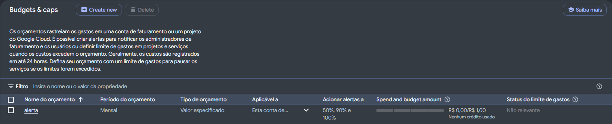
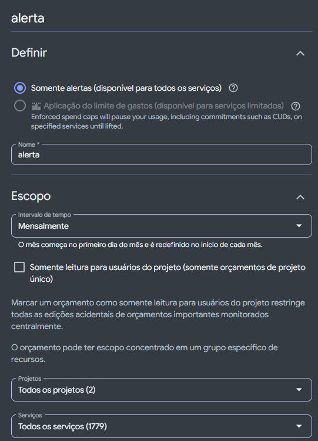
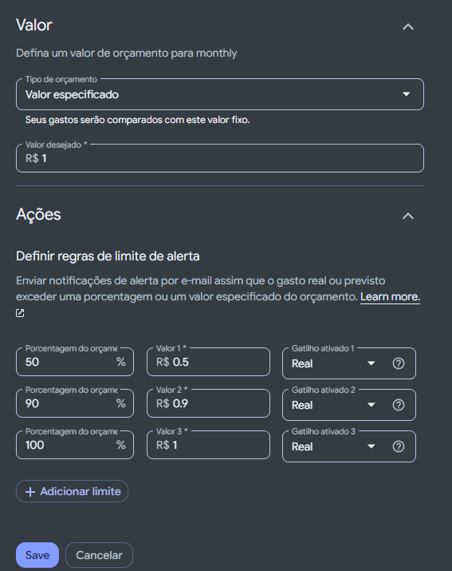

# Definição de Orçamento de Billing  - GCP
Resolução do desafio da DIO para criação de alertas e controle de orçamento no painel de faturamento do Google Cloud Platform.

---

## Principais Pontos Considerados

- **Escopo Abrangente**: Monitoramento **mensal** aplicado a **todos os projetos** e **todos os serviços** da conta de faturamento para evitar custos ocultos em qualquer recurso provisionado.
- **Modo de Ação (Somente Alertas)**: Foco na notificação preventiva dos administradores sem interromper abruptamente os serviços em execução.
- **Teto de Segurança (Valor Especificado)**: Definição de um orçamento fixo baixo (`R$ 1,00`), ideal para ambientes de estudo/laboratório (Free Tier) onde qualquer cobrança inesperada deve ser identificada imediatamente.
- **Gatilhos Progressivos (Gasto Real)**: Regras de alerta escalonadas em **50%** (`R$ 0,50`), **90%** (`R$ 0,90`) e **100%** (`R$ 1,00`) do valor orçado para acompanhamento gradual do consumo.

---

## Prints da Configuração

### 1. Visão Geral do Orçamento (`Budgets & caps`)

### 2. Definição e Escopo

### 3. Valor e Regras de Limite de Alerta

