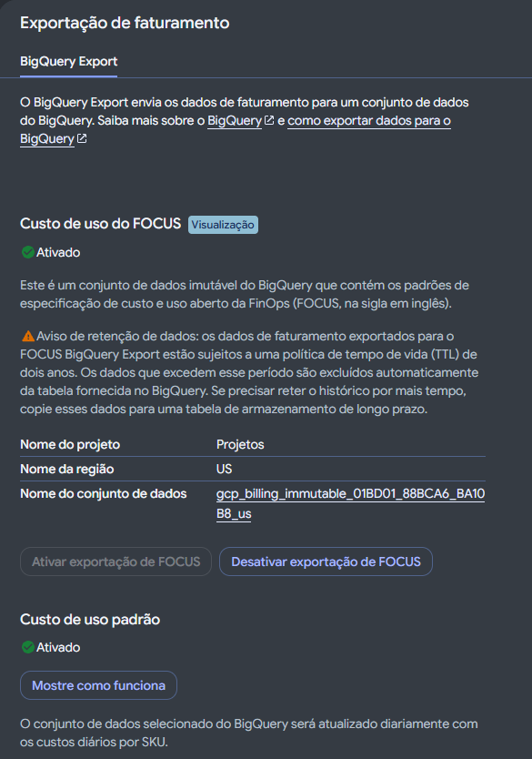

# Exportação de Faturamento (Billing) para o BigQuery - GCP

Resolução do desafio da DIO para exportação dos dados de faturamento (Cloud Billing) para o Google BigQuery, permitindo análises detalhadas de custos e consumo.

---

## O Que Foi Executado (Passo a Passo)

1. **Preparação no BigQuery**:
   - Seleção do projeto centralizador (`Projetos`) e definição/criação do conjunto de dados (*Dataset*) na multirregião `US` para armazenar os registros de faturamento.
2. **Acesso ao Painel de Exportação**:
   - Navegação no Console do GCP até **Faturamento (Billing) > Exportação de faturamento (Billing export)**, aba **BigQuery Export**.
3. **Ativação da Exportação de Custo de Uso Padrão (*Standard usage cost*)**:
   - Habilitação do envio diário automático dos custos gerais por SKU para o dataset selecionado no BigQuery.
4. **Ativação do Custo de Uso do FOCUS (*FinOps Open Cost and Usage Specification*)**:
   - Habilitação do conjunto de dados imutável no padrão aberto FinOps (`gcp_billing_immutable_01BD01_88BCA6_BA10B8_us` na região `US`), facilitando consultas padronizadas de custos e uso.

---

## Print da Configuração

### Painel BigQuery Export Ativado

