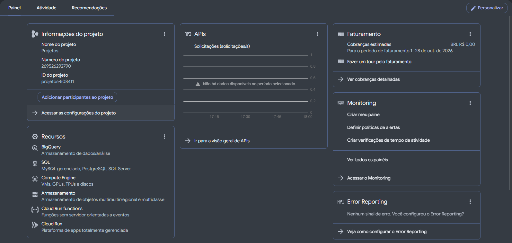

# Personalizando Dashboard e Preferências de Idioma - GCP

Resolução do desafio da DIO para personalização do painel principal (*Dashboard*) e configuração das preferências de idioma no Console do Google Cloud Platform.

---

## O Que Foi Executado

1. **Alteração de Idioma e Região**:
   - Acesso às **Preferências (Preferences) > Idioma e região (Language & Region)** no menu superior do Console GCP.
   - Modificação do idioma da interface para **Português (Brasil)**, facilitando a leitura de métricas, menus e relatórios de faturamento.
2. **Personalização do Painel (*Dashboard*)**:
   - Utilização do botão **Personalizar** no canto superior direito da aba **Painel**.
   - Remoção de cartões promocionais, tutoriais e widgets não utilizados no dia a dia (*Getting Started*, *Notícias*, *Documentação*, *Trace*, etc.).
   - Organização do layout focada nos cartões essenciais de operação e governança:
     - **Informações do projeto** (`Projetos` / `projetos-508411`)
     - **Recursos** (acesso rápido ao BigQuery, SQL, Compute Engine, Cloud Storage e Cloud Run)
     - **APIs** (monitoramento de tráfego/solicitações por segundo)
     - **Faturamento** (acompanhamento imediato das cobranças estimadas)
     - **Monitoring** e **Error Reporting** (observabilidade e saúde dos serviços)

---

## Print da Configuração

### Painel Personalizado em Português

