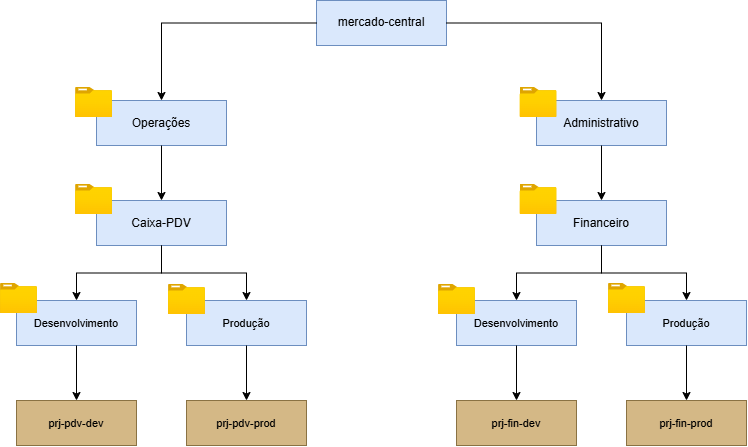

# Terraform: Hierarquia e Governança GCP - Mercado Central

Resolução do desafio da DIO para organização de pastas, projetos e grupos de acesso (IAM) no Google Cloud Platform.

---

## Diagrama

## Grupos de Acesso
- *Desenvolvedores*: `roles/editor` apenas nas pastas de `Desenvolvimento`.
- *Operações / Suporte*: `roles/viewer` nas pastas de `Producao`.
